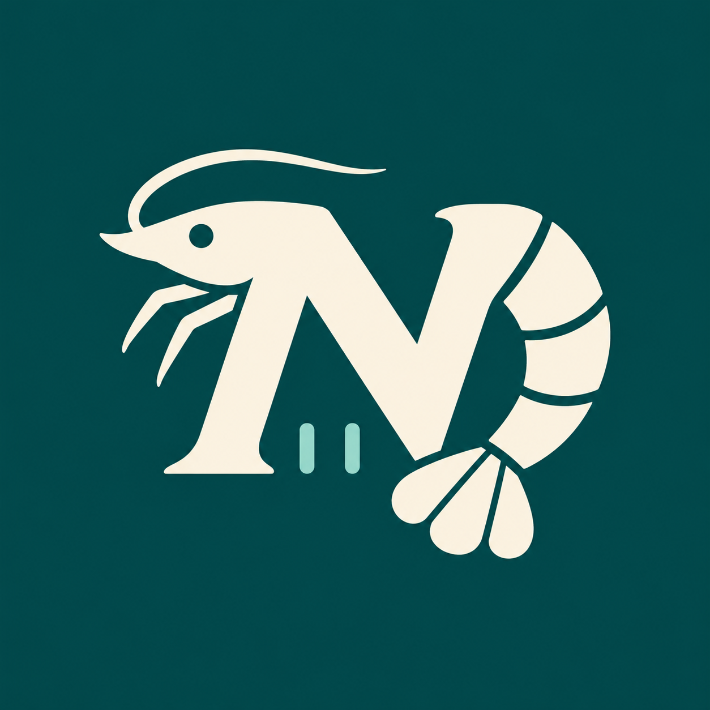

# ShrimpMetric

ShrimpMetric là dự án app Flutter để chụp, đếm và phân tích mẫu tôm trên Android và iPhone. Android là nền tảng phát triển và kiểm thử đầu tiên. Dự án hiện ở giai đoạn lập kế hoạch.

- [Ghi chú yêu cầu](APP-NOTES.md)
- [Kế hoạch triển khai](docs/PLAN.md)
- [Roadmap](docs/ROADMAP.md)
- [Các quyết định kiến trúc](docs/ADR.md)
